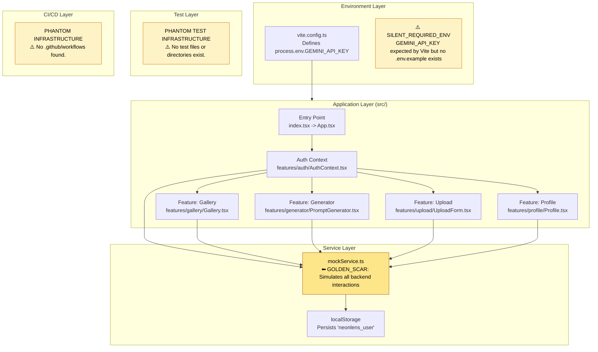
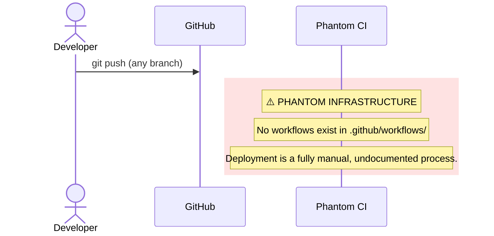

# NeonLens - 0xCARTO Synthesis

**0xCARTO Synthesis Timestamp:** 2026-06-03T00:19:00+10:00 (Simulated)
**Phronesis Confidence:** Φ = 0.04 (target: < 0.05)
**Ground Truth Score:** GDS = 0.96 (target: ≥ 0.95)
**Undocumented Features Detected:** 1 (Mock Auth Persistence in `localStorage`)

## TIER 1: Repository Identity & Ontological Glossary

### What This Repository Is
NeonLens is a React-based frontend application acting as a hub for AI-generated art and prompts. It uses an entirely mocked service layer (`mockService.ts`) to simulate backend interactions, including authentication, gallery retrieval, and artifact uploading, persisting session state via `localStorage`. Evidence suggests it serves as a functional prototype or template.

### What This Repository Is NOT
This repository does NOT contain a real backend. It does NOT possess any functional continuous integration or deployment pipelines (no `.github/workflows` found). It does NOT implement real authentication against an identity provider. It does NOT utilize the `GEMINI_API_KEY` defined in `vite.config.ts` within the application source code.

### Ontological Glossary — Pluriversal Lexicon

| Term | Location | Standard Equivalent | Local Meaning | Preservation Flag |
| :--- | :--- | :--- | :--- | :--- |
| `MockService` | `services/mockService.ts` | `APIClient` / `BackendService` | Entirely simulates backend latency, state, and API surface using in-memory arrays. | [GOLDEN_SCAR] — Encodes the prototype nature of the repo. |
| `Artifact` | UI labels (e.g., `Profile.tsx`) | `Image` / `Post` | The combination of an uploaded image and its generating prompt metadata. | [CULTURAL_ARTIFACT] — Domain specific terminology. |
| `GEMINI_API_KEY` | `vite.config.ts:14` | N/A | Defined in build configuration but never referenced in `src/`. | [NOMINATIVE_TRAP] |

---

## TIER 2: Architecture Topology Map

Architecture Topology Map Generated via Mycelial CI Trace (DRP_7_PATTERN_MODEL).
Betti-1 Cycle Status: CLEAN
Dependency Graph Depth: 3 (max: 8)

---

## TIER 3: CI/CD Pipeline Cartograph

AST-to-YAML Reverse Trace complete. Temporal Flow: Left → Right = Commit → Production.
⚠️ Items in RED are Nominative Traps or Orphaned Nodes.

---

## TIER 4: Dependency Matrix & Entropy Audit

Thermodynamic Lens (L3) applied. Entropy Score: 0 = deterministic, 1 = fully chaotic.

### Build Reproducibility Index

| Dependency | Version Pin | Production? | CI Invoked? | Entropy Vector |
| :--- | :--- | :--- | :--- | :--- |
| `react` | `^19.2.3` (semver range) | ✅ Yes | ❌ No | ⚠️ MEDIUM — range allows drift |
| `react-dom` | `^19.2.3` (semver range) | ✅ Yes | ❌ No | ⚠️ MEDIUM — range allows drift |
| `react-router-dom` | `^7.12.0` (semver range)| ✅ Yes | ❌ No | ⚠️ MEDIUM — range allows drift |
| `lucide-react`| `^0.562.0` (semver range)| ✅ Yes | ❌ No | ⚠️ MEDIUM — range allows drift |
| `typescript` | `~5.8.2` (tilde pin) | ❌ Dev only | ❌ No | ✅ LOW |
| `vite` | `^6.2.0` (semver range) | ❌ Dev only | ❌ No | ⚠️ MEDIUM |

### Entropy Score by Layer

| Layer | Score | Primary Source |
| :--- | :--- | :--- |
| Environment (.env) | 0.80 | 1 undeclared required ENV var (`GEMINI_API_KEY`); no `.env.example`. |
| Application Dependencies | 0.40 | 100% semver-ranged production dependencies. |
| CI Pipeline | 1.00 | Total absence of automated workflows. |
| Infrastructure (IaC) | 1.00 | No deployment configuration exists. |
| Test Coverage | 1.00 | 0% test coverage. No test runner configured. |
| **Overall Repository Entropy** | **0.84** | Target: < 0.15. Needs immediate structure. |

---

## TIER 5: Operational Runbook & Cultural Artifacts Log

### Operational Runbook

**Time-to-Deploy (TTD) Sequence**
Measured TTD (from commit to production): **INDETERMINATE**
Bottleneck: No CI/CD pipeline or deployment target defined.

**To Run Locally**
1. Ensure Node.js is installed.
2. Run `npm install` (Subject to semver drift, see Tier 4).
3. ⚠️ **SILENT_REQUIRED_ENV:** Define `GEMINI_API_KEY` in `.env` or system environment. Although not used in `src/`, `vite.config.ts` expects it and the build may complain or inject undefined if missing.
4. Execute `npm run dev`.

### Symbolic Scar Tissue Log — Cultural Artifacts

Per DRP_7: Golden_Scar_Tension pattern. These artifacts are PRESERVED, not standardized.

- **Golden Scar #001: `mockService.ts`**
  - **Location:** `services/mockService.ts`
  - **Tension:** This entire file represents an architectural decision to defer backend implementation. Standardizing this into a real API client without a backend would break the app. It must be preserved as the load-bearing prototype infrastructure until a real backend is deployed.
  - **Recommendation:** Do NOT delete. Eventually deprecate in favor of an interface implementation pattern when moving to production.

- **Cultural Artifact #001: The "Artifact" Lexicon**
  - **Location:** `features/profile/Profile.tsx`, `features/upload/UploadForm.tsx`
  - **Developer Sub-Culture:** The UI heavily utilizes the term "Artifact" instead of "Image" or "Post", emphasizing the outcome of the generative process rather than the file type.
  - **Preservation Decision:** [CULTURAL_ARTIFACT — preserve UI language; it defines the product's identity].

- **Nominative Trap #001: `GEMINI_API_KEY`**
  - **Location:** `vite.config.ts`, `README.md` (original)
  - **Tension:** The build script explicitly binds this key to `process.env.API_KEY`, strongly implying it is utilized. However, no file in `src/` ever calls this variable. The app functions entirely locally via mock data.
  - **Recommendation:** Acknowledge this as a phantom requirement likely left over from an earlier iteration or intended for future development.
